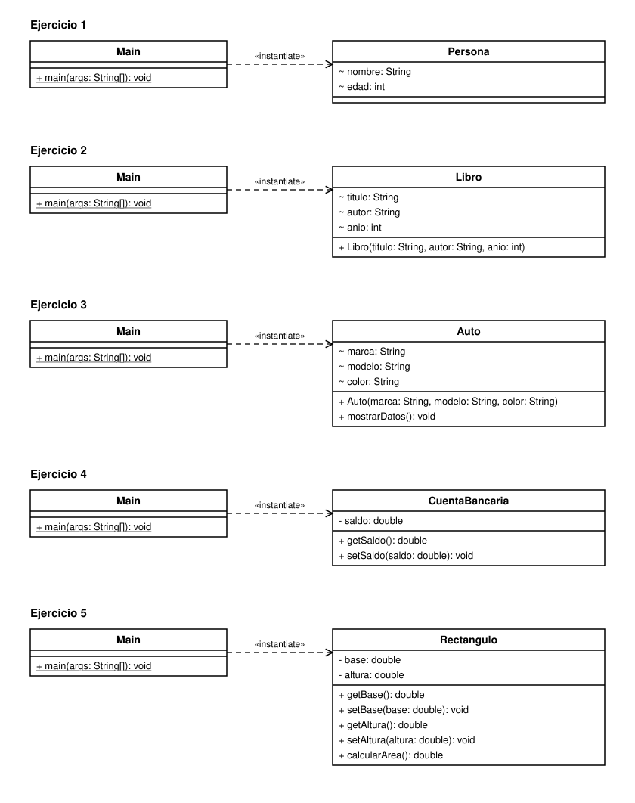

# TP Clases y Objetos (Java)

Trabajo práctico de Programación Orientada a Objetos: clases, objetos, constructores, métodos y encapsulamiento.

## Estructura

    src/
      ejercicio1/   Persona, Main
      ejercicio2/   Libro, Main
      ejercicio3/   Auto, Main
      ejercicio4/   CuentaBancaria, Main
      ejercicio5/   Rectangulo, Main
    docs/
      uml-clases.drawio   diagrama editable en draw.io
      uml-clases.svg      diagrama para visualizar

## Ejercicios

1. **Persona**: atributos nombre y edad, dos objetos creados en el Main y mostrados por consola.
2. **Libro**: atributos titulo, autor y año, con constructor.
3. **Auto**: atributos marca, modelo y color, con el método mostrarDatos().
4. **CuentaBancaria**: atributo privado saldo con get y set.
5. **Rectangulo**: atributos privados base y altura con get y set, y cálculo del área.
6. **Diagramas de clases UML** de cada ejercicio en la carpeta docs.

## Cómo ejecutarlo

Desde la raíz del repositorio (Java 11 o superior):

    javac -d out src/*/*.java
    java -cp out ejercicio1.Main

Cambiar ejercicio1 por ejercicio2, ejercicio3, etc. para correr cada uno.

## Diagrama UML

